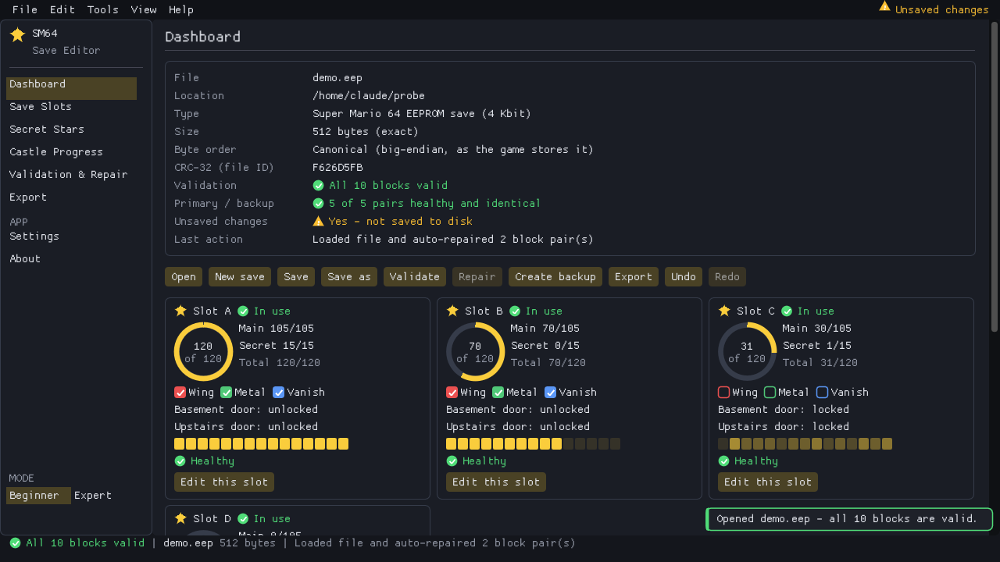
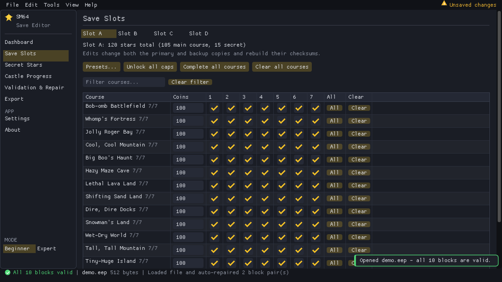
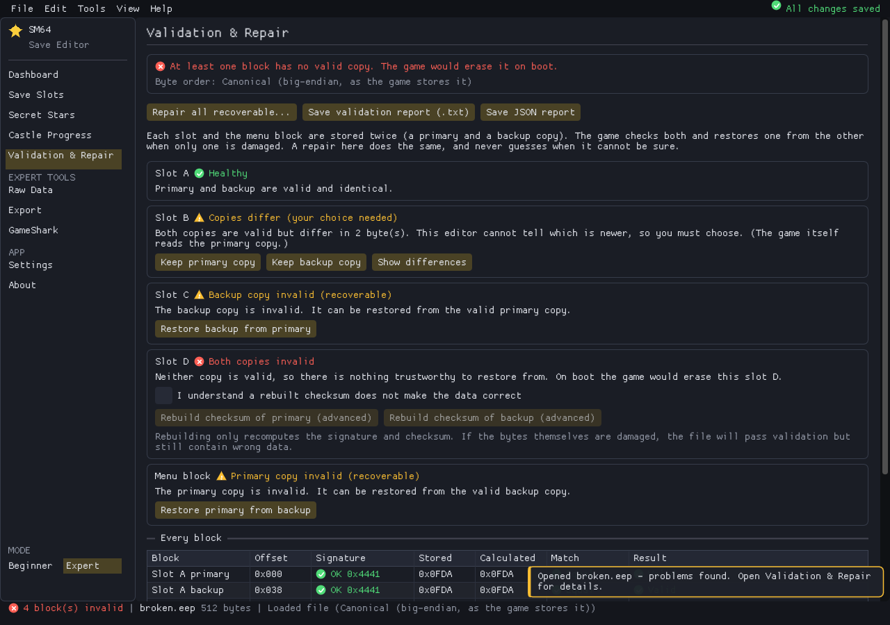
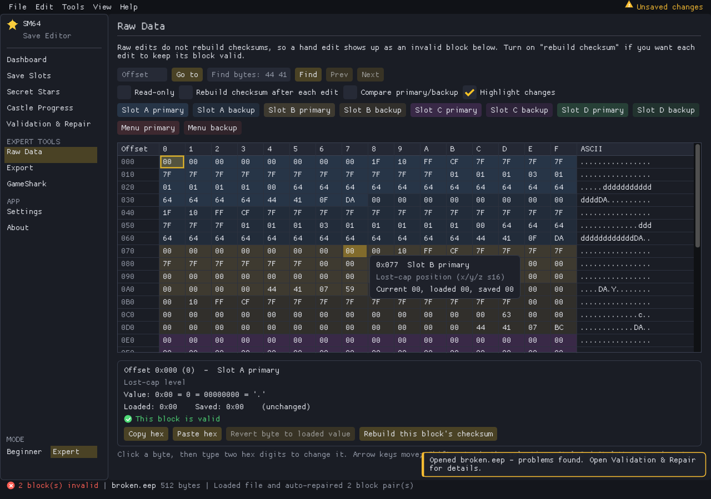
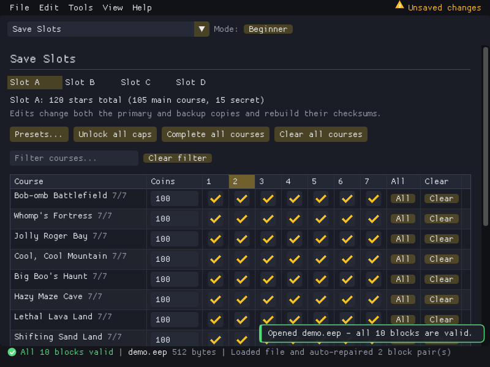

# SM64 Ultimate Save Editor

A cross-platform desktop editor for **Super Mario 64 EEPROM saves** (the 512-byte `.eep`, `.bin` or `.sav` files
used by emulators and flashcarts). It is built with C++20, SDL2, OpenGL and Dear ImGui.

It is meant to be friendly if you have never seen a hex editor, and deep enough to inspect every byte if you have.

| Save slots | Validation & repair | Hex editor (Expert) | 800×600 |
|---|---|---|---|
|  |  |  |  |

*Screenshots are real captures of the Linux build running under a virtual display with software OpenGL.*

> **Always keep a copy of your original save.** The editor writes a `.bak` file whenever it overwrites something and
> verifies every file it writes by reading it back, but a second copy of the original costs nothing.

## Two modes, one app

| | Beginner (default) | Expert |
|---|---|---|
| Courses, stars, coins, caps, keys, doors | yes, with plain names | yes |
| Presets with a preview (70 stars, 120 stars, unlock caps ...) | yes | yes |
| Undo / redo, history, unsaved-change list | yes | yes |
| Validation & repair with explanations | yes | plus per-block signature/checksum table |
| Raw hex editor, search, compare primary/backup | hidden | yes |
| GameShark code generator | hidden | yes |

Switch any time from the sidebar, the **View** menu, or the command palette (`Ctrl+K`). Validation is never hidden.

## Getting the app

**From GitHub Actions** (no compiler needed): open the repository's *Actions* tab, pick the latest successful run of
*Build SM64 Ultimate*, and download the artifact for your system (`SM64-Ultimate-Windows-x64`, `SM64-Ultimate-Linux-x64`
or `SM64-Ultimate-macOS`). Tagged releases attach the same files.

**From source:** see [BUILDING.md](BUILDING.md).

## Using it

1. **Open** a save: `File > Open`, `Ctrl+O`, or drag the file onto the window. The file must be exactly 512 bytes. 16-bit and
   32-bit byte-swapped dumps are detected and converted automatically.
2. **Edit**: *Save Slots* (stars + coin high scores per course), *Secret Stars* (the 15 extra stars), *Castle Progress*
   (cap switches, keys, doors). Amber highlights show what differs from the saved file.
3. **Check**: *Validation & Repair* shows whether every block is healthy.
4. **Save**: `Ctrl+S` saves in place and **keeps the file's extension** (`.bin` stays `.bin`, `.eep` stays `.eep`). `Save as`
   offers `.eep`, `.bin` or `.sav`. Output is always exactly 512 bytes.

### Preserving originals

* Every overwrite first copies the existing file to `<name>.<ext>.bak` (turn this off in *Settings*).
* *Create backup copy* writes a timestamped copy next to the file.
* Writes are atomic: the data goes to `<name>.tmp`, is flushed and size-checked, and only then replaces the destination. If
  anything fails, your original is untouched.
* *Read-only forensic mode* (Settings) disables editing and saving entirely.

### Why can't I edit lives?

The retail game keeps lives in runtime state only. There is no lives field in the EEPROM, so any "lives" editor would be
changing an unrelated byte. The total star count is also not stored; it is calculated from the star flags, and the editor
shows the same number the game would.

### How cap switches work

A cap switch flag only unlocks the matching coloured cap blocks (red = Wing, green = Metal, blue = Vanish). It does not make
Mario wear a cap permanently, and Wing Cap flight still needs a normal in-game triple jump or a cannon launch.

### Why GameShark addresses vary

The RDRAM address of the save buffer differs between ROM regions, revisions, hacks and ports. No address has been verified
for all of them, so the GameShark page asks you for it and warns you. The codes it generates are `80xxxxxx 00VV` (8-bit) and
`81xxxxxx VVVV` (16-bit).

### What validation and repair can and cannot do

* **Can:** check each block's signature and checksum, compare each primary with its backup, and restore a block that has
  exactly one valid copy from that copy (the same recovery the game itself performs).
* **Will not:** guess which copy is newer when both are valid but different (you choose), or pretend an unrecoverable block
  was recovered.
* **Cannot:** know whether the data inside a self-consistent block is what you intended. Rebuilding a checksum (an explicit
  Expert action) makes a block *pass* validation; it does not make wrong data right.

## Emulator and flashcart notes

* Put the `.eep` file where your emulator keeps EEPROM saves for SM64 and make sure the file name matches what the emulator
  expects for your ROM. Locations and names differ per emulator; check its documentation.
* Flashcart profiles in the Export page write the canonical 512 bytes. No device-specific transformation is documented, so
  those profiles are labelled *experimental*. Back up the card's original save before replacing it.
* The `.sra` option is a 32 KiB compatibility wrapper only; retail SM64 uses EEPROM, not SRAM.

## Troubleshooting

* **"File is N bytes ... exactly 512 bytes"**: the file is not an SM64 EEPROM dump. Some emulators store EEPROM inside a larger
  container; extract the 512-byte EEPROM first.
* **File dialogs do nothing on Linux**: install `zenity` or `kdialog`. Drag-and-drop and passing a file on the command line
  work without them.
* **UI too small/large**: *Settings > UI size* multiplies the operating-system scaling.
* **Blocks show as invalid after a raw hex edit**: that is intended. Raw edits do not rebuild checksums; use *Rebuild checksum*
  in the hex editor's inspector, or enable it per edit.

## Developer flags

`sm64-ultimate [file] [--page N] [--expert] [--size WxH] [--dpi S] [--frames N --screenshot out.ppm] [--no-tour]`

## License

No license file is present in this repository yet. Until the owner adds one, all rights are reserved by default. This project
bundles no ROMs, game assets or firmware and is not affiliated with Nintendo. Third-party libraries (SDL2, Dear ImGui,
portable-file-dialogs) keep their own licenses.

See also: [SAVE_FORMAT.md](SAVE_FORMAT.md), [MIGRATION.md](MIGRATION.md), [CONTRIBUTING.md](CONTRIBUTING.md),
[CHANGELOG.md](CHANGELOG.md).
